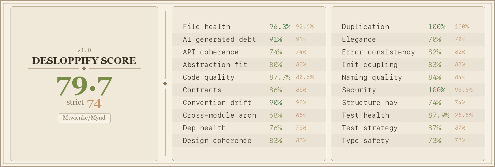

# Mynd v0.1

A local-first Python research library that ingests PDFs from an inbox, stores
metadata in SQLite, and writes readable paper notes into an Obsidian vault.



## Project layout

The installable code lives under `src/` and is split by responsibility:

| Package | Responsibility |
| --- | --- |
| `mynd` | CLI, ingestion coordinator, settings, shared contracts, file and identity primitives |
| `mynd.ingestion` | PDF text and GROBID bibliography extraction |
| `mynd.resolution` | DOI normalization, Crossref lookup, and reference resolution |
| `mynd.storage` | SQLite schema and row-level persistence helpers |
| `mynd.vault` | Obsidian note rendering and citation linking |
| `mynd.ai` | Local Ollama backend, runtime controls, and summarization |
| `mynd.questionnize` | Study questions generated from a paper's summary |

Every domain package is nested under the `mynd` distribution package, so a
normal install exposes only `mynd` as a top-level import.

## Requirements

- Python 3.11+
- Internet access for Crossref metadata lookups
- Ollama with a local text model (default `qwen3:8b`) for summaries; ingestion
  continues without a summary when Ollama or the model is unavailable
- Optional: a local GROBID service for bibliography extraction

## Install

From this directory:

```bash
python -m venv .venv
# macOS/Linux:
source .venv/bin/activate
# Windows PowerShell:
# .venv\Scripts\Activate.ps1

python -m pip install -c constraints.txt -e ".[dev]"
```

Edit `config.toml` and set `vault_path` to your actual Obsidian vault directory.
Paths in `config.toml` are resolved relative to that file when they are not absolute.

Then run:

```bash
mynd doctor
pytest
```

Copy PDFs into the configured inbox (`./vault/00 Inbox` by default), then run:

```bash
mynd ingest
mynd review-queue
```

Open the configured vault in Obsidian. Notes are written under `10 Papers/`.

When a model is available, ingesting a new paper also writes an **Extracted
questions** chapter: three questions about the main idea, four about the
methodology, and three about specific findings. To regenerate those questions
for an already ingested paper, pass its note path, paper ID, or DOI:

```bash
mynd questionnize "Obsidian/MyndVault/10 Papers/A Study (abcdef123456).md"
mynd questionnize doi-abcdef123456
mynd questionnize 10.1234/study
```

## Inference modes and thermal response

Choose a reduced-resource profile when starting ingestion:

```bash
mynd ingest --mode silent
```

While ingestion is running, change its mode from another terminal:

```bash
mynd mode silent
mynd mode normal
```

Mode changes take effect on the next model request. Resource profiles and thermal control are active only in `silent` mode. On macOS, Mynd pauses model generation at `serious` or `critical` and resumes when the state drops below `serious`. When [`macmon`](https://github.com/vladkens/macmon) is installed, any fan RPM above 0 selects the extra-low profile for the next silent-mode request. Install macmon with `brew install macmon`; use `--verbose` to see CPU/GPU temperatures and fan RPM after model requests and PDFs. On other operating systems, manual modes work but automatic thermal response is not implemented.

Use `mynd ingest --verbose` in either mode to see Ollama request options, generation timing/token statistics, and model allocation changes reported by Ollama. Verbose diagnostics report runtime information without enabling the silent profile.

## Optional bibliography extraction with GROBID

GROBID is not bundled with this project. If Docker is installed, start a local instance:

```bash
docker run --rm --init -p 8070:8070 lfoppiano/grobid:0.9.1
```

Keep that process running, then ingest PDFs. If GROBID is unavailable, the PDF and note still ingest; references will not be extracted in that run.

## Current limitations

- The prototype finds a DOI in extracted PDF text and enriches metadata via Crossref.
- Citation extraction requires GROBID; reference resolution is strongest when a DOI is present.
- References to papers not yet in the vault are marked `external`, not automatically downloaded.
- When the configured model is available, ingestion creates an AI summary,
  tentative reference annotations, and ten extracted study questions. If it is
  unavailable, ingestion continues and the note records that no summary was
  generated. Questions are based only on the generated summary, not the full
  paper text.
- Scanned PDFs may require OCR.
- PDF processing and API responses should be tested against your own paper collection before relying on the generated graph.

## Privacy

PDFs, extracted text, and SQLite data are stored locally. Crossref receives DOI lookup requests, and a locally run GROBID service receives the PDF for bibliography extraction. Extracted paper text (excluding a terminal bibliography) is sent to the configured Ollama model on your machine for summarization and reference annotation. Mynd has no hosted-model backend: summarization always runs locally, and if Ollama or the model is unavailable, ingestion continues without a summary.
